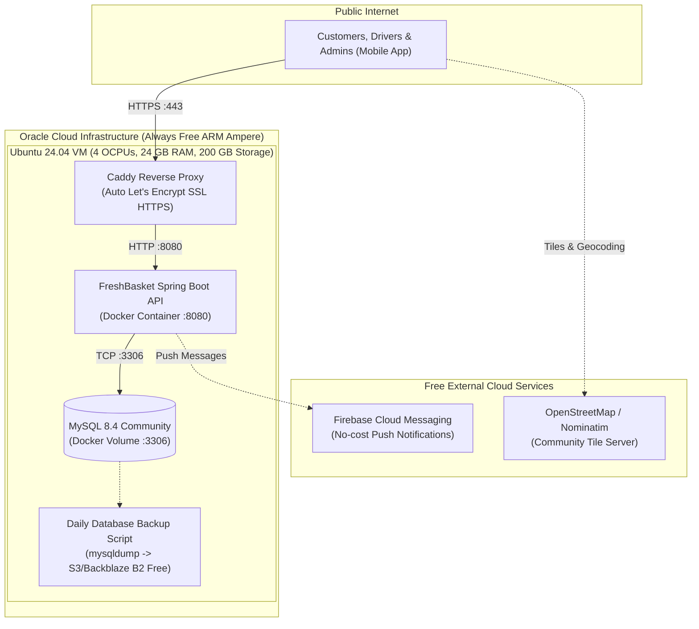
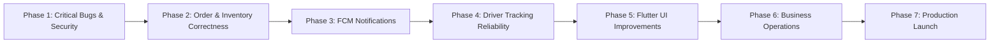

# FreshBasket – Production Readiness & Free Deployment Blueprint

**Date:** November 2026  
**Auditor:** Principal Software Architect & DevOps Lead  
**Scope:** Production Readiness Evaluation, Zero-Cost Cloud Deployment, Free-Tier Limits, and Prioritized Implementation Roadmap.

---

## 1. Production Readiness Scorecard

| Pillar | Score (1-10) | Evaluation | Key Gaps to Launch |
| :--- | :---: | :--- | :--- |
| **Core Business Logic** | **8 / 10** | Strong order flow, atomic checkout, inventory transactions, OTP delivery validation. | Missing `DELIVERY_FAILED` state, driver reassignment, and shop operating hours. |
| **Data Integrity & Safety** | **9 / 10** | Row-level locking on inventory, Flyway versioned schemas, money scaled to 2 decimal places. | Need checkout idempotency key in database schema. |
| **Security & RBAC** | **7 / 10** | Strong BCrypt password and OTP hashing, strict Spring Security route guards. | Lacks rate limiting on `/login` and token refresh mechanism. |
| **Telemetry & Real-Time** | **6 / 10** | FCM architecture designed; GPS telemetry operational when app in foreground. | Requires Android Foreground Service so GPS persists when driver opens maps. |
| **Observability & Logs** | **5 / 10** | Spring Boot console logging; audit trail in DB tables. | Needs structured JSON logs, health checks (`/actuator/health`), and automated DB backups. |
| **Mobile Client UX** | **8 / 10** | Fresh vegetable Material 3 theme, responsive catalog, product details, admin dashboard. | Needs in-app address management and reorder button. |
| **Deployment Readiness** | **6 / 10** | Docker Compose configured for MySQL; Maven and Flutter build cleanly. | Needs Dockerfile for Spring Boot backend and reverse proxy configuration with SSL. |

---

## 2. Zero-Cost Production Deployment Blueprint

FreshBasket can be operated completely **free of cost** using generous always-free cloud tiers:



### 2.1 Recommended Free-Tier Hosting: Oracle Cloud Infrastructure (OCI) Always-Free
- **Compute Instance**: 1 VM.Standard.A1.Flex (ARM Ampere, up to 4 cores, 24 GB RAM, completely free forever).
- **Storage**: 200 GB Block Storage (always free).
- **Bandwidth**: 10 TB outbound traffic per month (more than sufficient for 10,000+ monthly vegetable orders).
- **Alternative Free Options**:
  - **Render.com / Railway.app**: Free/hobby tier (subject to sleep/spin-down or monthly credit caps; not recommended for 24/7 store uptime).
  - **Shop Physical Machine (Self-Hosted)**: An old office laptop or Raspberry Pi 4 running Docker with a free Cloudflare Tunnel (`cloudflared`) providing free HTTPS and DDoS protection without port forwarding.

### 2.2 Free SSL & Reverse Proxy Setup (Caddy)
Caddy automatically provisions and renews SSL certificates from Let's Encrypt for free:
```caddy
api.freshbasket.shop {
    reverse_proxy localhost:8080
}
```

### 2.3 Automated Database Backups (Zero-Cost)
Configure a daily cron job dumping MySQL to **Backblaze B2** (10 GB always free storage):
```bash
0 2 * * * docker exec freshbasket-mysql mysqldump -u freshbasket -pfreshbasket freshbasket | gzip > /backups/freshbasket-$(date +\%F).sql.gz
```

---

## 3. Free Technology Limits & Operational Boundaries

| Service / Tool | Free Tier Allowance | Operational Boundary / Safeguard |
| :--- | :--- | :--- |
| **Firebase Cloud Messaging** | Completely free with unlimited messages. | Must stay within FCM payload limits (4 KB data payload); do not send large images over push. |
| **OpenStreetMap (OSM)** | Free community tile servers. | Must adhere to OSM tile usage policy: max 2 requests/sec; set custom User-Agent in Flutter map requests; do not bulk-download map tiles. |
| **MySQL 8.4 Community** | Free and open source (GPL). | Single node instance; schedule nightly logical backups via `mysqldump`. |
| **Spring Boot 3.4 & Java 17** | Free open source (Eclipse Temurin / OpenJDK). | No license fees. |
| **Android Play Store Account** | $25 one-time registration fee. | One-time developer fee; ongoing distribution is free. For internal shop testing, direct APK sideloading is 100% free. |

---

## 4. Prioritized Implementation Roadmap

Following Section 15 execution guidelines, the recommended development roadmap is structured into 7 sequential phases:



### Phase 1: Critical Bugs & Security Hardening
- **Token Refresh**: Implement refresh token endpoint (`/api/auth/refresh`) and Dio interceptor retry logic to prevent 60-minute session drops.
- **Rate Limiter**: Add token-bucket rate limiter to prevent password brute-forcing on `/api/auth/login`.
- **Checkout Idempotency**: Add `idempotencyKey` to `CheckoutRequest` and a unique constraint in `orders` to eliminate double-order risks under unstable 4G networks.

### Phase 2: Order & Inventory Correctness
- **Order State Machine**: Add `DELIVERY_FAILED` status to `OrderStatus` and `AssignmentStatus`.
- **Driver Reassignment**: Update `DeliveryService` to permit reassignment of orders to new drivers if initial delivery fails or vehicle breaks down.
- **Delivery Cutoff Hours**: Implement morning (7:00 AM) and evening (3:30 PM) slot cutoffs in backend validation and Flutter UI.

### Phase 3: Push Notification System Verification
- Install genuine `google-services.json` in Android app.
- Provide `FIREBASE_CREDENTIALS` service-account JSON in production backend environment.
- Verify push receipt on physical devices in background, foreground, and terminated app states.

### Phase 4: Driver Tracking Reliability
- **Android Foreground Service**: Build a native Android Service with ongoing notification so GPS updates continue uninterrupted when drivers use Google Maps.
- **Stale Location Warning**: Highlight in the customer UI if driver location updates are older than 2 minutes.

### Phase 5: Flutter UI Enhancements
- **Saved Addresses**: Allow customers to save multiple delivery addresses ("Home", "Shop") with single-tap checkout selection.
- **Reorder Button**: Allow customers to re-populate the cart from past completed orders with one click.
- **Receipt Summary**: Printable/shareable text or PDF receipt in customer order details.

### Phase 6: Business & Financial Operations
- **Shop Operating Hours**: Database table `shop_settings` with opening/closing hours and temporary closure banner.
- **COD Reconciliation Dashboard**: Admin settlement workflow for recording and clearing cash collected by drivers.
- **Aggregated Analytics**: Server-side queries for daily revenue, top-selling vegetables, and driver delivery performance.

### Phase 7: Production Packaging & Launch
- Dockerize Spring Boot backend (`eclipse-temurin:17-jre-alpine`).
- Configure Caddy reverse proxy with automated Let's Encrypt SSL.
- Setup automated daily backup script for MySQL database to free cloud storage.
- Admin bootstrap execution and initial catalog seeding for local shop launch.
