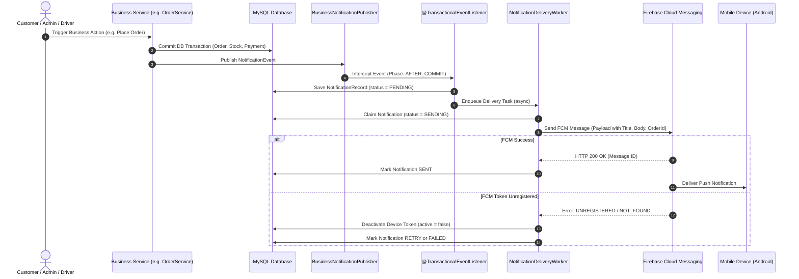

# FreshBasket – Real-Time Notification & Live GPS Workflow

**Date:** November 2026  
**Auditor:** Principal Mobile & Cloud Systems Architect  
**Scope:** Firebase Cloud Messaging (FCM), Push Notification Lifecycle, Android MethodChannels, and Driver Live Location Telemetry.

---

## 1. Real-Time Notification System (FCM)

FreshBasket implements a zero-cost asynchronous push notification engine using Firebase Cloud Messaging (FCM) paired with an in-database notification center in MySQL.

### 1.1 Architecture & Component Flow



### 1.2 Event Catalog & Targeted Personas

| Trigger Event | Event Type | Target Persona | Deduplication Key Format | Notification Content |
| :--- | :--- | :--- | :--- | :--- |
| Customer places order | `ORDER_PLACED` | All Active Admins | `ORDER_PLACED:{orderId}` | "New order received" – "Order FB-XXXX was placed." |
| Admin accepts order | `ORDER_ACCEPTED` | Order Customer | `ORDER_ACCEPTED:{orderId}:ACCEPTED` | "Order update" – "Order FB-XXXX was accepted." |
| Admin prepares order | `ORDER_PREPARING` | Order Customer | `ORDER_PREPARING:{orderId}:PREPARING` | "Order update" – "Order FB-XXXX is being prepared." |
| Packing complete | `ORDER_READY` | Order Customer | `ORDER_READY:{orderId}:READY_FOR_PICKUP`| "Order update" – "Order FB-XXXX is ready for pickup." |
| Admin assigns driver | `DRIVER_ASSIGNED` | Assigned Driver & Customer | `DRIVER_ASSIGNED_DRIVER:{orderId}:{driverId}` | "New delivery assigned" – "Order FB-XXXX is ready for delivery." |
| Driver picks up order | `OUT_FOR_DELIVERY` | Order Customer | `OUT_FOR_DELIVERY:{orderId}:OUT_FOR_DELIVERY` | "Order update" – "Order FB-XXXX is out for delivery." |
| OTP verified delivery | `ORDER_DELIVERED` | Order Customer & All Admins | `ORDER_DELIVERED:{orderId}:DELIVERED` | "Order update" – "Order FB-XXXX was delivered." |
| Order cancellation | `ORDER_CANCELLED` | Order Customer & All Admins | `ORDER_CANCELLED:{orderId}:CANCELLED` | "Order update" – "Order FB-XXXX was cancelled." |
| Stock drops below min | `LOW_STOCK` | All Active Admins | `LOW_STOCK:{productId}:{txId}` | "Low stock alert" – "{Vegetable} stock is low (X remaining)." |

### 1.3 Key Technical Highlights & Resiliency
1. **Transaction Isolation**: Notifications are dispatched only **after** the database transaction commits successfully (`TransactionPhase.AFTER_COMMIT`). If checkout rolls back due to a stock error, no false notification is ever emitted.
2. **Deduplication Constraint**: Table `notifications` enforces a unique constraint on `(user_id, deduplication_key)`. Duplicate events cannot spam users.
3. **Graceful Degraded Mode**: If `FIREBASE_ENABLED=false` or credentials are unset, notifications are stored safely in MySQL and accessible via the `/api/notifications` REST API. The application never crashes due to missing Firebase keys.
4. **Invalid Token Auto-Pruning**: When FCM returns `MessagingErrorCode.UNREGISTERED`, the backend marks `device_tokens.active = false` immediately, preventing repeated failed attempts.
5. **Exponential Retry Scheduler**: [NotificationWorkers.java](file:///C:/Users/dudim/OneDrive/Desktop/Vegetables/backend/src/main/java/in/freshbasket/notifications/NotificationWorkers.java) runs a `@Scheduled` worker that retries failed deliveries up to 3 times before abandoning them.

### 1.4 Flutter Client Lifecycle
In [push_notifications_service.dart](file:///C:/Users/dudim/OneDrive/Desktop/Vegetables/flutter_app/lib/features/notifications/push_notifications_service.dart):
- **Initialization**: Requests notification permissions on Android 13+ (`POST_NOTIFICATIONS`).
- **Foreground Display**: Incoming FCM messages while the app is open trigger a native Android `NotificationChannel` (`freshbasket_orders`) display via `MainActivity.kt`.
- **Background Execution**: Headless callback `firebaseBackgroundMessageHandler` processes push notifications when app is backgrounded or terminated.
- **Deep Linking**: Tapping any notification invokes `onOrderOpened`, navigating the customer or driver directly to the corresponding order details.

---

## 2. Live Driver Location Telemetry

FreshBasket enables real-time tracking of drivers during active deliveries so customers can monitor transit.

### 2.1 Current Telemetry Pipeline

```mermaid
flowchart LR
    DriverApp["Driver Phone\n(Flutter + Android GPS)"] -->|POST /api/driver/location\n(Every 15 seconds)| Backend["Spring Boot\nDeliveryService"]
    Backend -->|Upsert Coordinates| DB[("driver_locations\nTable in MySQL")]
    CustomerApp["Customer Phone\n(Polling /api/orders/my\nEvery 15s)"] -->|GET /api/orders/my| Backend
    Backend -->|DriverLocationResponse| CustomerApp
    CustomerApp -->|Click 'Track Driver'| Maps["Google Maps\n(External Web / App Intent)"]
```

### 2.2 Telemetry Rules & Security Boundaries
1. **Driver Opt-In**: Drivers must explicitly toggle the "Share Location" switch on the dispatch screen.
2. **Delivery State Enforcement**: Location updates are rejected with `409 Conflict` unless the driver has an assignment in `ACCEPTED` or `PICKED_UP` state. Drivers cannot be tracked when offline or idle.
3. **Data Boundary**: Customer API responses omit driver location coordinates unless the order is actively `OUT_FOR_DELIVERY`.
4. **Automatic Teardown**: As soon as the driver enters the correct customer OTP and marks the order `DELIVERED`, the driver's location record is deactivated (`active = false`).

### 2.3 Operational Deficiencies & Required Enhancements

| Current Implementation | Operational Problem | Required Production Fix |
| :--- | :--- | :--- |
| **Foreground-Only Timer**: Location is cancelled when app is paused (`didChangeAppLifecycleState != resumed`). | When drivers switch to Google Maps or phone dialer to navigate or call the customer, location telemetry halts completely. | Implement an Android **Foreground Service** with a persistent system notification (`startForegroundService`). GPS updates will continue while driver navigates in external apps. |
| **External URL Launch**: Tapping "Track Driver" launches an external browser or Google Maps app. | Disrupts customer experience by leaving the FreshBasket application. | Embed an in-app map widget (e.g. OpenStreetMap via `flutter_map` or Google Maps SDK) showing customer house pin and driver vehicle marker. |
| **No Stale Detection**: Returns coordinates regardless of when they were captured. | If a driver enters a cellular dead zone or their battery dies, the customer sees an outdated pin with no indication of signal loss. | Compute age of coordinates: if `updated_at > 2 minutes ago`, display "Driver GPS signal paused" warning badge. |

---

## 3. Production Deployment Prerequisites for Real-Time Services

To activate full live push delivery and tracking:
1. **Firebase Console**:
   - Create a Firebase project (`freshbasket-prod`).
   - Register the Android package `com.example.freshbasket`.
   - Download `google-services.json` and place it in `flutter_app/android/app/`.
2. **Backend Service Account**:
   - Generate a private service account key (`freshbasket-firebase-admin.json`) from Project Settings $\rightarrow$ Service Accounts.
   - Store it outside the git repository (e.g., `/etc/freshbasket/firebase-key.json`).
   - Set environment variables:
     ```bash
     FIREBASE_ENABLED=true
     FIREBASE_CREDENTIALS=/etc/freshbasket/firebase-key.json
     FIREBASE_PROJECT_ID=freshbasket-prod
     ```
3. **Android Location Permissions**:
   - Ensure `ACCESS_FINE_LOCATION` and `ACCESS_COARSE_LOCATION` are declared in `AndroidManifest.xml`.
   - For Android 10+ background telemetry via Foreground Service, add `FOREGROUND_SERVICE` and `FOREGROUND_SERVICE_LOCATION` permissions.
